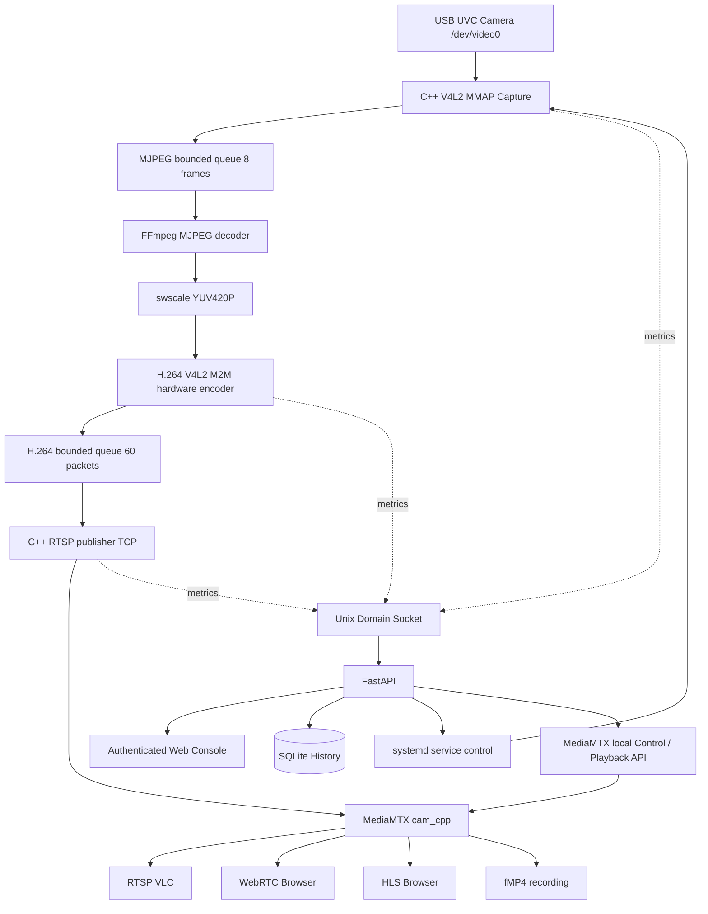

# 系统架构设计

## 1. 核心目标

在 Raspberry Pi 4B 上构建一个支持实时视频采集、H.264 硬件编码、局域网多协议播放、故障自恢复、管理 API 和历史监控的视频网关。

设计原则：**视频数据面与业务控制面分离**；C++ 负责实时路径，Python 负责管理与监控，MediaMTX 负责视频分发和录像。

## 2. 总体架构图



## 3. 实时数据面与线程

| 线程 | 主要职责 | 边界 |
| --- | --- | --- |
| 采集主线程 | V4L2 打开设备、设置 MJPEG 1280×720@30、MMAP 帧采集 | 复制完整 JPEG 到 MJPEG 有界队列；不参与网络 I/O |
| 视频工作线程 | FFmpeg MJPEG 解码、像素格式转换、H.264 硬件编码 | 将 `AVPacket` 克隆到 H.264 有界队列 |
| 网络工作线程 | RTSP over TCP 发布、异常检测与重连 | 网络堵塞不直接阻塞解码线程；队列满时允许丢弃过期数据 |
| 指标线程 | Unix Domain Socket 监听，本机 JSON 快照 | 只读计数器和队列统计，不读写视频数据 |

**关键细节**：硬件编码器输出 H.264 Annex B，RTSP 会话首次建立或重连时需要 SPS/PPS 与关键帧同步；重连逻辑会等待 IDR 并附带缓存参数集。

## 4. 时间戳与帧率

- 捕获时间由 `std::chrono::steady_clock` 记录，用于计算编码 PTS。
- 编码器配置 `time_base=1/30`、目标 GOP 约 30 帧、无 B 帧。
- RTSP 发布前通过 `av_packet_rescale_ts` 将时间戳转换为视频流时间基。
- 页面上 `capture_fps` 是最近一次约 10 秒窗口的平均采集 FPS；`encode_fps` 在实现中来自**编码数据包计数变化率**，严格称为“编码包速率”，通常接近 30 包/秒。

## 5. 低延迟与可靠性取舍

- MJPEG 帧队列默认容量 8；H.264 包队列默认容量 60。
- 队列满时丢弃最旧数据，优先避免实时视频无限积累延迟。需要同时观察队列丢弃、同步丢弃和 RTSP 网络错误这三个不同指标。
- 播放端推荐浏览器 WebRTC；RTSP 客户端 VLC 在实测环境中需启用 **RTSP over TCP**，300 ms 缓存可流畅播放。
- HLS 相比 WebRTC 可能存在更多缓存和更高延迟；稳定性视客户端和网络而定。

## 6. 控制面

| 组件 | 说明 |
| --- | --- |
| systemd | 管理 `rpi-video-gateway`、`rpi-mediamtx`、`rpi-video-api`、`rpi-recording-guard` |
| FastAPI | 管理员认证、摄像头启停、媒体管理代理、指标与历史查询 |
| Unix Socket | `runtime/data/gateway_metrics.sock`；`kai` 用户所有，目标权限 `0600` |
| SQLite | `runtime/data/gateway_history.sqlite3`；由 FastAPI 单进程后台采样线程维护 |
| MediaMTX Control API | `127.0.0.1:9997`；动态开关 `cam_cpp` 录制 |
| MediaMTX Playback API | `127.0.0.1:9996`；列出录像时间段并导出 MP4 |

## 7. 录像路径

```text
H.264 encoder --> RTSP --> MediaMTX --> fMP4 recording segments
                                        |
                                        +--> local playback API --> FastAPI --> browser MP4
```

录像使用已有 H.264 编码流，避免二次编码。录像安全守护进程周期性查询磁盘空间、录制目录大小及当前录制时长；超过阈值时调用 MediaMTX Control API 关闭录像，正常直播继续。

默认保护参数：低于 1 GiB 可用空间、录像目录达到 4 GiB 或单次录制超过 1800 秒；MediaMTX 配置中默认 1 天保留时间。上述是**配置目标**，需要按测试表实际验证守护行为。

## 8. 已知边界

- 当前 `rpi-video-gateway` 为单设备固定参数；尚未提供设备热插拔完整恢复流程。
- FPS 指标约 10 秒更新一次；网页 3 秒轮询并不意味着 FPS 3 秒重算。
- SQLite 历史采集依赖单个 FastAPI 进程；不要简单增加 `uvicorn --workers`。
- 当前 MP4 浏览器回放代理未实现完整 HTTP Range 透传；大文件拖动进度条可能受限。
- HTTP 登录保护并未保护 MediaMTX 的独立播放端口。
- 多日/24 小时稳定性与断电数据完整性还需专门实测。
